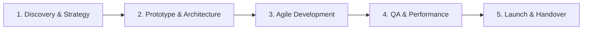

# 💼 Client Services & Engagement Guide

Hello! I am a **Creative Frontend Engineer & Mobile Application Developer**. I partner with founders, venture-backed startups, boutique agencies, and luxury brands to design and engineer distinctive digital experiences.

---

## 🛠️ Core Services

### 1. Bespoke Websites & Digital Brand Flagships
- **Luxury & Editorial Sites:** Custom layouts, bespoke typography, and storytelling architectures (Hospitality, Architecture, Fashion, Real Estate).
- **Interactive Portfolio & Agency Sites:** Unforgettable visual branding with custom motion.
- **Conversion-Driven Landing Pages:** Blazing fast load times with clear visual hierarchy.

### 2. Mobile Application Engineering
- **Cross-Platform Apps:** iOS & Android apps built with **React Native / Expo** or **Flutter**.
- **Progressive Web Applications (PWAs):** Offline-first web applications that install directly to mobile home screens with native feel.
- **Companion Mobile Ecosystems:** Syncing web, mobile, and backend APIs seamlessly.

### 3. Creative Engineering & Motion UI
- **Micro-Interactions & Physics:** GSAP, ScrollTrigger, Framer Motion, Lenis smooth scrolling.
- **Interactive 3D / WebGL:** Three.js and Canvas canvas experiences.
- **Design System Architecture:** Scalable tokens, component libraries, and Figma-to-code implementations.

### 4. Full-Stack Web Applications
- **Frontend:** React, Next.js, Vue, Nuxt, Svelte, or Vanilla TypeScript.
- **Backend & APIs:** Node.js, Express, Python, REST, GraphQL, Supabase, Firebase.
- **Hosting & CI/CD:** Vercel, Netlify, AWS, Cloudflare, automated GitHub Actions.

---

## 📋 How We Work Together

1. **Discovery & Scope (Week 1):** We align on brand vision, target audience, technical requirements, and milestones.
2. **Interactive Prototype (Week 1–2):** Live staging prototypes so you can touch, test, and feel the interactions early.
3. **Core Development:** Clean, well-documented, test-covered code with weekly staging releases.
4. **Optimization & Performance Audit:** Guaranteeing 90+ Google Lighthouse scores, mobile responsiveness, and cross-browser stability.
5. **Deployment & Support:** Seamless launch, domain configuration, documentation, and handover.

---

## 📬 Contact & Inquiries

Ready to build something exceptional? Let's discuss your project:

- ✉️ **Email:** [siddh2803@gmail.com](mailto:siddh2803@gmail.com)
- 🐙 **GitHub:** [@siddh2803-ryu](https://github.com/siddh2803-ryu)
- 🌐 **Portfolio Website:** [siddharthdhawan.com](https://siddharthdhawan.com)
